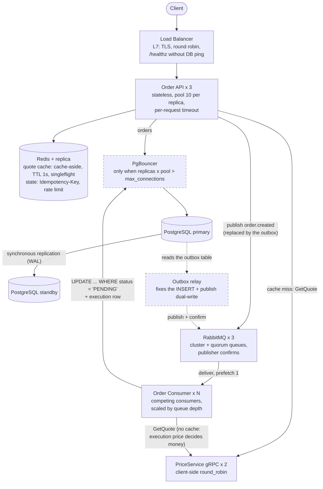

# Scaling the investment-engine to 1M users (design exercise)

Study design from the roadmap's system design day (Oct 10-12, 2026).
It is **not implemented**: it describes how the investment-engine
(v1.0.0) would evolve, which is why it lives here and not in the
project's README.

## Back-of-the-envelope numbers

| Assumption | Value |
|---|---|
| Registered users | 1,000,000 |
| Daily active users | 10% = 100,000 |
| Orders per active user per day | 2 |
| Reads per active user per day | 50 |
| Active window | 7 h of B3 trading (~25,000 s) |
| Peak factor | 3x (market open) |

| Metric | Peak | Fits on one machine? |
|---|---|---|
| Writes (orders) | ~25/s | yes |
| Reads | ~600/s | yes |
| Queue messages | ~25/s (~6M/month) | yes (but above the CloudAMQP free plan) |
| Storage | ~30 GB/year (orders + executions) | yes |

Conclusion: volume is not the problem. The risks are the peak at market
open, the sequential execution path, database connections and single
points of failure.

## Target architecture

Dashed boxes are later steps, added only when needed.

## Decisions by component

| Component | What breaks first | Fix |
|---|---|---|
| Consumer | 1 sequential worker (~20/s) below the ~25/s peak: the queue grows, orders wait minutes in PENDING with no error logged | Competing consumers; safe thanks to the conditional UPDATE (idempotency) |
| API | One replica = outage on every crash or deploy | 3 stateless replicas behind an L7 load balancer, graceful shutdown drains them |
| DB connections | `sql.DB` pool is unbounded per process | `SetMaxOpenConns` per process, connection budget, PgBouncer later |
| Quotes | Display reads hit the price origin | Redis cache-aside (TTL 1s) + singleflight; never cache the execution price |
| PriceService | HTTP/2 pins each client to one replica | 2 replicas + gRPC client-side round_robin |
| PostgreSQL | Single point of failure; outages longer than the ~10s retry window send orders to the DLQ | Primary + synchronous standby (RPO 0), automatic failover, longer retry backoff, backups with PITR |
| RabbitMQ | Single node; a publish can be lost without confirms | 3-node cluster with quorum queues (2f+1), publisher confirms, transactional outbox |
